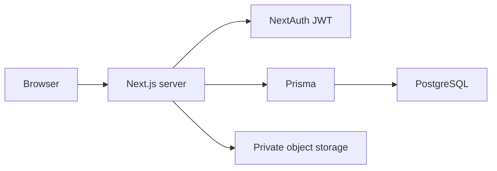
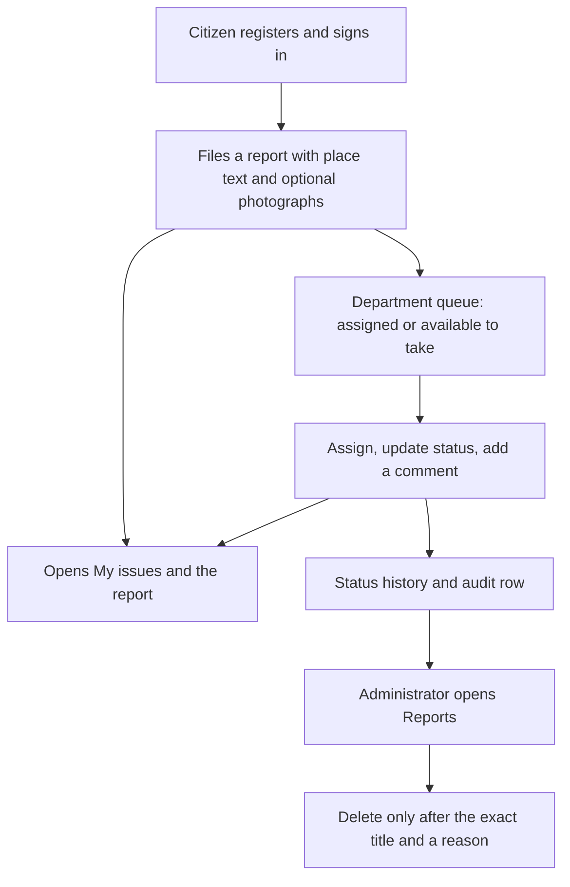

# CivicFix

Civic issue reporting and resolution for citizens, department staff, and administrators.

CivicFix is the workspace where a resident files a street, sanitation, water, or safety report, a department takes it through a controlled status path, and an administrator can review the record without bypassing authorization. The interface uses a warm cream and espresso theme. Location is text the citizen types. Precise coordinates are not collected on the report form and are not shown on public pages.

The repository overview is also in the parent [README](../README.md). Commands on this page run from `my-app`.

## Architecture

The browser talks to a Next.js App Router server. Sessions are JSON Web Tokens. Issue rows, status history, memberships, and audit logs live in PostgreSQL. Photograph bytes live in a private storage bucket. The database stores only the object key.



| Concern | How it works | What that protects |
| --- | --- | --- |
| Identity | Credentials session, optional Google sign-in | Role and department come from the server, not the form |
| Reports | One transaction for the issue, location, and opening history | A failed write does not leave a partial report |
| Photographs | Magic-byte check, private bucket, UUID object key | The reporter or the assigned department can read the file |
| Department work | Active membership plus an allowed status pair | Staff cannot jump a report into an illegal status |
| Administration | Both administrator capabilities required | Signed-out users, citizens, and staff cannot manage or delete reports |
| Deletion | Exact title, a reason, then hide the row and remove stored files | History and the audit record stay |

Server Actions accept a report body up to 25 MB so four photographs can arrive together. Each file is still limited to 5 MB, and a report still accepts at most four JPEG, PNG, or WebP images.

## System flow



Status changes follow the seeded pairs: Reported can move to Under review or Assigned, then through Verified, In progress, Resolved, and Closed. Reopening and rejection stay closed unless a later pair is added, and those paths require a reason.

## Who uses it

**Citizens** register, file a report, and follow it from My issues. They cannot change status, assign a department, or open another person's report.

**Department staff** open the queue when the account has the staff role and one active membership. They assign work inside their own department, change status only through an allowed pair, and leave a comment the reporter can read. Department analytics stay on that signed-in department.

**Administrators** need both administrator capabilities. They manage departments, categories, and users, read organization analytics, browse every report, and delete one only by typing its title and a reason. A pure administrator does not receive a special pass to photograph bytes. The image route still allows the reporter or the assigned department.

## Tech stack

| Layer | Technology | Role |
| --- | --- | --- |
| Framework | Next.js 16, App Router | Pages, Server Actions, and route protection |
| Language | TypeScript | Application and test code |
| UI | React 19, Tailwind CSS 4 | Cream and espresso interface |
| Database | Prisma 7 and PostgreSQL | Issues, accounts, memberships, history, audit |
| Photographs | Supabase Storage, private bucket | Bytes stay off the public internet |
| Auth | NextAuth.js 4, Argon2id | JWT sessions and password hashes |
| Charts | Recharts | Administrator and department analytics |

## Local development

Requires Node.js 20 or newer, a PostgreSQL database, and a private storage bucket before photographs will upload.

```bash
npm install
npx prisma generate
npm run dev
```

Open [http://localhost:3000](http://localhost:3000).

Apply the existing SQL migrations when the database is empty. Do not reset a database that already holds accounts or reports.

## Environment

Copy `.env.example` to `.env`. Every variable is server-only. Do not add a `NEXT_PUBLIC_` prefix, and do not commit the filled file.

| Key | Required | Purpose |
| --- | --- | --- |
| `DATABASE_URL` | Yes | Pooled PostgreSQL URL used at runtime |
| `DIRECT_URL` | Yes | Direct PostgreSQL URL used by the Prisma CLI |
| `NEXTAUTH_SECRET` or `AUTH_SECRET` | Yes | Signs the session cookie |
| `NEXTAUTH_URL` | Yes | Public origin, with no path, such as `http://localhost:3000` |
| `TRUSTED_PROXY_HOPS` | Yes | How many proxies may append `X-Forwarded-For` |
| `GOOGLE_CLIENT_ID` and `GOOGLE_CLIENT_SECRET` | No | Google sign-in. Leave both empty to hide it |
| `SUPABASE_URL` | Yes, for photographs | Storage project URL |
| `SUPABASE_SECRET_KEY` | Yes, for photographs | Server-only storage key |
| `SUPABASE_STORAGE_BUCKET` | Yes, for photographs | Private bucket name |

## First data

Seeding and the first administrator are explicit commands. They do not run on install, build, or startup.

```bash
npm run db:seed-roles
npm run db:seed-categories
npm run db:seed-transitions
```

Role seeding upserts the four roles. Category seeding upserts the eight starter categories and does not delete other categories. Transition seeding inserts the eight allowed status pairs and does not delete other pairs.

The first administrator can be created only while the user table is empty. Set `BOOTSTRAP_ADMIN_CONFIRM=yes` plus the email, name, and password in the process environment for that one command. Do not put the password in `.env`.

```powershell
$env:BOOTSTRAP_ADMIN_CONFIRM = "yes"
$env:BOOTSTRAP_ADMIN_EMAIL = "you@example.com"
$env:BOOTSTRAP_ADMIN_NAME = "Your Name"
$env:BOOTSTRAP_ADMIN_PASSWORD = "<password of 12 to 128 characters>"
npm run admin:bootstrap
Remove-Item Env:BOOTSTRAP_ADMIN_PASSWORD
```

There is no email delivery and no self-service password reset. A signed-in person can change a password at `/account/password`. An administrator delivers a new staff password through a separate channel. The department queue opens for an active member without forcing that change.

## Routes

| Area | Paths |
| --- | --- |
| Citizen | `/register`, `/login`, `/report`, `/my-issues`, `/issues/[id]`, `/account` |
| Department | `/department`, `/department/issues/[id]`, `/department/analytics` |
| Administration | `/admin`, `/admin/analytics`, `/admin/departments`, `/admin/categories`, `/admin/users`, `/admin/issues` |
| Photographs | `/api/issue-images/[imageId]` |

Explore and Notifications are not part of the interface. Department updates can still write notification rows. Citizens follow a report from My issues.

## Checks

```bash
npm test
npm run lint
npx tsc --noEmit
npm run build
```

`npm run build` generates the Prisma client and then builds Next.js.

## Project layout

- `src/app/` — routes, layouts, and styles
- `src/components/` — forms, shell, and analytics views
- `src/lib/` — authorization, issues, photographs, administration, and analytics
- `prisma/` — schema, migrations, and explicit seed commands
